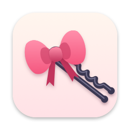

# Hairpin

<p align="center"></p>

<p align="center">
  <a href="https://github.com/HiAriesZhou/Hairpin/releases/latest"></a>
  <a href="https://github.com/HiAriesZhou/Hairpin/actions/workflows/ci.yml"></a>
  
  <a href="LICENSE"></a>
</p>

A tiny macOS menu bar app that keeps the icons hidden behind the MacBook notch within reach.
一个极简的 macOS 菜单栏小工具：把被 MacBook 刘海挡住的菜单栏图标收起来，随时点得到。

**[Download Hairpin.dmg](https://github.com/HiAriesZhou/Hairpin/releases/latest/download/Hairpin.dmg)** · [hairpin.arieszhou.com](https://hairpin.arieszhou.com) · [English](#english) · [中文](#中文)

> Formerly **NotchBar**. If you cloned the old repository: `git remote set-url origin https://github.com/HiAriesZhou/Hairpin.git`

---

## English

### What it does

When there are more menu bar icons than fit beside the notch, macOS quietly hides the rest. Hairpin notices, and puts a small hairpin at the left end of your menu bar icons that holds the hidden ones.

- **Hover or click the hairpin** and the hidden icons drop down in a row. Click one to open its menu.
- **Only there when needed.** With nothing hidden, there's no hairpin.
- **Keeps up** as you switch apps (long app menus included), as icons come and go, and as the menu bar hides itself or goes full screen.
- **Looks right:** icons as they appear in your menu bar, in a Liquid Glass row on macOS 26.

### Install

1. Download [**Hairpin.dmg**](https://github.com/HiAriesZhou/Hairpin/releases/latest/download/Hairpin.dmg) from the latest release, open it and drag Hairpin onto Applications. (`Hairpin.zip` on the [Releases](https://github.com/HiAriesZhou/Hairpin/releases/latest) page holds the same app.)
2. Open Hairpin. Releases are signed with a Developer ID and notarized by Apple, so it opens without a warning.
3. Turn on **Accessibility** for Hairpin when it asks.

Requires macOS 13 or later on Apple silicon. Real icon looks need macOS 14; the Liquid Glass row needs macOS 26.

### Permissions and privacy

- **Accessibility (required)** lets Hairpin read other apps' menu bar icons and click them for you. Turn it on in System Settings › Privacy & Security › Accessibility.
- **Screen Recording (optional, macOS 14+)** lets Hairpin show icons as they look and tell exactly which app each belongs to. Without it, and for icons that have never been visible, the row shows the app's own icon instead (Apple's icons show an initial in a rounded square). Grant it from **Show Real Icons…** in Hairpin's menu.

Hairpin makes no network connections, doesn't log keystrokes and doesn't read app windows. With Screen Recording it captures only the menu bar strip, to cut out icon shapes, and reads menu bar item windows' names; the shapes stay in memory.

### Using Hairpin

- **Open the row:** rest the pointer on the hairpin for half a second (it closes when you move away), or click it (it stays until you click elsewhere, click the hairpin again or press Escape).
- **Order:** Apple's icons on the right, the others by when their app launched, the earliest rightmost, as in the menu bar.
- **Hairpin's menu:** click Hairpin's own icon (right-click it while it's the hairpin) for the number of hidden icons, **Show Real Icons…**, **Open on Hover**, **Launch at Login** and **Quit Hairpin**.
- **Can't find Hairpin?** Open Hairpin.app again while it's running. The hidden icons drop down at the pointer, or the menu appears if none are hidden.

### Limitations

- Hairpin doesn't move icons; it clicks the real one. Some apps open their menu by the notch, where it was hidden, and a few ignore the click or open a window instead.
- An icon's look is captured while it's shown, so anything that changes (unread counts, battery level) shows as it last looked.
- With several displays, only the notched one (or the primary one) counts.
- Apple silicon only.

[How Hairpin works](docs/how-it-works.md) explains the details.

### Build from source

```sh
swift test               # unit tests
scripts/bundle.sh        # Hairpin.app and Hairpin.zip, ad hoc signed
scripts/dmg.sh           # then Hairpin.dmg
```

Needs Xcode or the Command Line Tools. An ad hoc build gets new privacy grants after every rebuild; `SIGN_IDENTITY="Apple Development" scripts/bundle.sh` signs it with a stable identity so they carry over.

---

## 中文

### 它做什么

菜单栏图标多到刘海旁边放不下时，macOS 会悄悄把放不下的藏起来。Hairpin 会注意到这一点，在菜单栏图标的最左端放一个小发卡，被藏起来的图标都收在里面。

- **悬停或点击发卡**，被藏起来的图标会在下方展开成一行；点一个就打开它的菜单。
- **只在需要时出现**：没有图标被藏起来时，发卡不会出现。
- **随时跟上**：切换应用（包括菜单很长的应用）、图标增减、菜单栏自动隐藏或进入全屏时，都会自动调整。
- **样子一致**：显示的就是图标在菜单栏上的样子；在 macOS 26 上用 Liquid Glass 效果。

### 安装

1. 下载最新正式版的 [**Hairpin.dmg**](https://github.com/HiAriesZhou/Hairpin/releases/latest/download/Hairpin.dmg)，打开后把 Hairpin 拖到「Applications」。（[Releases](https://github.com/HiAriesZhou/Hairpin/releases/latest) 页面上的 `Hairpin.zip` 里是同一个 app。）
2. 打开 Hairpin。发布版使用 Developer ID 签名并经过 Apple 公证，可以直接打开，不会有安全提示。
3. 按提示为 Hairpin 打开「辅助功能」权限。

需要 macOS 13 或更高版本、Apple 芯片。显示图标的真实样子需要 macOS 14；Liquid Glass 效果需要 macOS 26。

### 权限与隐私

- **辅助功能（必需）**：用来读取其他应用的菜单栏图标，并替你点击它们。在「系统设置 › 隐私与安全性 › 辅助功能」里打开。
- **屏幕录制（可选，macOS 14 及以上）**：用来显示图标的真实样子，并准确识别每个图标属于哪个应用。不授权时，被藏起来的图标显示为圆角方框里的应用首字母。可以从 Hairpin 菜单里的 **Show Real Icons…** 授权。

Hairpin 不联网，不记录按键，也不读取应用窗口的内容。授予屏幕录制后，它只截取菜单栏这一条来抠出图标形状，并读取菜单栏图标窗口的名称；图标形状只保存在内存里。

### 使用

- **展开**：鼠标在发卡上停留半秒（移开后收起），或者点击发卡（保持展开，直到点击别处、再点一次发卡或按 Esc）。
- **顺序**：系统图标在最右边，其余按应用启动先后排列，越早启动越靠右，和菜单栏一致。
- **Hairpin 菜单**：点击 Hairpin 自己的图标（它兼当发卡时用右键），可以看到被藏起来的图标数量，以及 **Show Real Icons…**、**Open on Hover**、**Launch at Login** 和 **Quit Hairpin**。
- **找不到 Hairpin？** 在它运行时再打开一次 Hairpin.app，被藏起来的图标会在鼠标指针处展开；没有图标被藏起来时，会弹出菜单。

### 已知限制

- Hairpin 不会移动图标，而是替你点击真实的图标。有些应用会在原来被藏起来的位置（刘海附近）弹出菜单，少数应用不响应点击，或者打开的是窗口。
- 图标的样子是在它显示时截取的，会变化的内容（未读数、电量）显示的是最后一次可见时的状态。
- 接了多块显示器时，只看带刘海的那块（没有刘海时看主屏）。
- 只支持 Apple 芯片。

技术细节见 [How Hairpin works](docs/how-it-works.md)。

### 从源码构建

```sh
swift test               # 单元测试
scripts/bundle.sh        # 生成 Hairpin.app 和 Hairpin.zip（ad-hoc 签名）
scripts/dmg.sh           # 再生成 Hairpin.dmg
```

需要 Xcode 或 Command Line Tools。ad-hoc 签名的构建每次重新打包后，系统授权都会失效；用 `SIGN_IDENTITY="Apple Development" scripts/bundle.sh` 以固定的证书签名，授权就能保留。

---

## Contributing and security · 贡献与安全

Contributions are welcome through pull requests; see [CONTRIBUTING.md](CONTRIBUTING.md). Report security issues privately as described in [SECURITY.md](SECURITY.md).
欢迎通过 PR 贡献，流程见 [CONTRIBUTING.md](CONTRIBUTING.md)；安全问题请按 [SECURITY.md](SECURITY.md) 私下报告。

## License

MIT, see [LICENSE](LICENSE). Written from scratch; no code from other menu bar managers. A copy ships inside the app at `Hairpin.app/Contents/Resources/LICENSE`.
